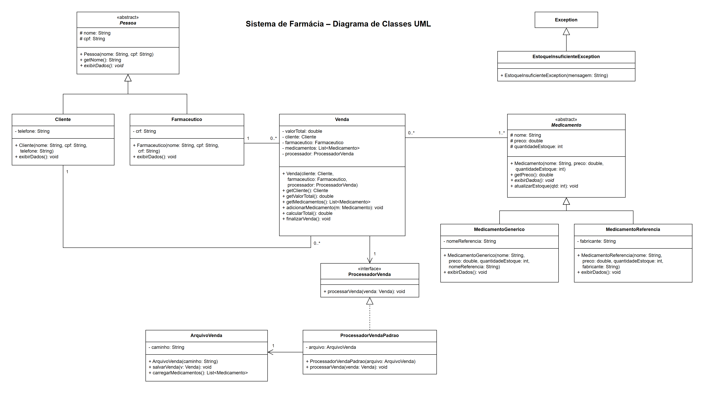

# Trabalho_POO_Farmacia

Sistema de farmácia em Java, desenvolvido como projeto final da disciplina C06 – Programação Orientada a Objetos.

## Integrantes

| Nome | Matrícula |
| --- | --- |
| Isabela Moreira Mendes | 2268 |
| Yasmim Custodio | 149 |

## Diagrama UML

O arquivo editável do diagrama está em [docs/uml-farmacia.drawio](docs/uml-farmacia.drawio) e pode ser aberto no [draw.io](https://app.diagrams.net).

## Utilização de Inteligência Artificial no Desenvolvimento

Cada integrante da dupla usou uma ferramenta de IA diferente, por isso as declarações estão separadas.

---

### Parte da Isabela

**Ferramenta utilizada:** Claude — Anthropic (Claude Code)

**Modelo:** Claude Opus 5.5

A IA foi utilizada principalmente como apoio para compreender o conteúdo de Programação Orientada a Objetos aplicado ao projeto: tirar dúvidas de conceitos, explicar erros de compilação e revisar o código. Em alguns momentos, também escreveu trechos de código a meu pedido, que foram revisados comigo linha por linha. As tarefas de organização em que a IA ajudou estão no fim desta seção.

#### Principais prompts utilizados (dúvidas sobre o conteúdo)

1. **UML e banco de dados**

   "ligações do uml sao as mesmas que estao sendo feitas no trabalho de bd"

   A IA explicou que as duas ligações dizem como uma coisa se relaciona com outra e em que quantidade: no UML é a multiplicidade, e no banco é a cardinalidade. A diferença está em como a ligação é guardada. No UML, a classe guarda o próprio objeto, e no banco, uma chave estrangeira. Herança, interface e métodos só existem no UML.

2. **Classe abstrata e método abstrato**

   "porque pessoa e uma classe abstrata? porque o metodo abstrato nao tem { }?" e "para ser abstrato precisa ser a classe mae?"

   A IA explicou que a classe abstrata não pode ser instanciada e serve de modelo para as filhas. O método abstrato não tem corpo porque cada filha é obrigada a implementá-lo, como o exibirDados() em Cliente e Farmaceutico.

3. **Atributos da subclasse, visibilidade e super**

   "o atributo telefone nao esta na mae como eu faço para incluir ele?" e "para que serve o -?"

   A IA explicou que o telefone pertence só à Cliente, e que o construtor da filha repassa nome e CPF para a mãe com super. Também explicou os símbolos do UML: - é private, # é protected e + é public.

4. **Atributo, parâmetro e construtor**

   "nao entendi o telefone ele precisa ficar dentro do construtor?"

   A IA explicou que o atributo é declarado fora do construtor e guarda o valor enquanto o objeto existir. O parâmetro é o valor que chega no new. Dentro do construtor, uma linha com this guarda o parâmetro no atributo.

5. **Chamada de método e polimorfismo**

   "como faz para chamar um metodo que esta na mae?"

   A IA explicou que o método é chamado pelo objeto. Quando a variável é do tipo Pessoa e o objeto é um Cliente, o Java executa a versão da Cliente, e isso é polimorfismo.

6. **Relações entre as classes**

   "como chama isso de criar um atributo que e uma classe?" e "seria uma agregação ja que um farmaceutico existe sem uma venda"

   A discussão diferenciou a relação "é um", que é herança, da relação "tem um", que é associação, e o caso da agregação, em que a parte existe sem o todo.

7. **Atributos ou lista**

   "o medicamento precisa de uma array porque ele guarda o nome e o preço?" e "porque dentro do <> nos usamos medicamento e fora medicamentos?"

   A IA explicou que os atributos guardam os dados de uma única coisa, e que uma lista guarda várias coisas do mesmo tipo. Por isso, cada Medicamento tem os próprios atributos, e a Venda tem uma `List<Medicamento>`. O tipo entre `< >` diz o que cada item é, e o nome fora dele é só o nome da variável.

8. **Valor total calculado**

   "posso chamar o tipo de venda de venda? o calcular total tiraria do valor da venda"

   A IA explicou que o Java diferencia maiúsculas de minúsculas, então o tipo Venda e a variável venda não se confundem. O valorTotal guarda o resultado, mas não é de onde a conta sai: o total é calculado somando o preço dos medicamentos da venda.

9. **Interface**

   "o que e o processador venda?"

   A IA explicou que a interface é um contrato e que a ProcessadorVendaPadrao o implementa. Com o retorno do professor, a Venda passou a usar a interface para processar a venda.

10. **Papel da classe Pessoa e o finalizarVenda()**

    "se nos estamos tirando a parte de pessoa para que serve esse bloco? como e chamada essa estrutura de finalizar venda?"

    A IA explicou que a Pessoa continua sendo a base da Cliente e da Farmaceutico: guarda nome e CPF, tem o construtor chamado pelo super e obriga as filhas a terem o exibirDados(). O finalizarVenda() delega o processamento ao objeto da interface.

11. **@Override, public e this**

    "para que serve o override? porque precisa colocar public antes de void? como fazer o processador processar o this?"

    A IA explicou que o @Override confere se o método realmente sobrescreve outro, que os métodos de interface são públicos, e que o this é o próprio objeto da venda.

12. **Chamada de métodos e getters**

    "para chamar um metodo na main, eu coloco a classe e depois o metodo?" e "porque colocamos o get dentro de venda?"

    A IA explicou que o método é chamado pelo objeto, e que o getter fica na classe dona do atributo, o que é encapsulamento.

13. **Buscar um objeto na lista**

    "para buscar o cliente apenas colocando um for ja iria funcionar?"

    A IA explicou a diferença entre percorrer a lista com for e buscar um objeto pela posição com get, lembrando que a lista começa na posição 0.

14. **Exceções**

    "try e catch e a mesma coisa que exceção?", "o que e throws?" e "throw e a mesma coisa que try/catch?"

    A IA explicou que a exceção é o problema e o try/catch é o tratamento. O throw lança a exceção, e o throws a repassa para quem chamou o método. Também mostrou como ler a mensagem de erro para descobrir o tipo da exceção.

15. **Nomes de variáveis**

    "por que o nome declarado no array list tem que ser diferente do declarado para criar um objeto farmaceutico?"

    A IA explicou que, dentro do mesmo método, cada variável precisa de um nome único, e que o plural é só uma convenção para indicar uma lista.

16. **Código sem uso**

    "tudo o que nao for usado na programação deve ser removido, logo o que aparece no usages deve ser removido"

    A IA mostrou que o aviso "no usages" do IntelliJ estava desatualizado e marcava métodos que eram usados. Conferindo o projeto inteiro, só dois getters não eram chamados, e eles foram removidos.

#### Outras tarefas em que a IA ajudou

- **Planejamento:** comecei o projeto por volta de 02/11. Depois, a IA montou um cronograma para os dias 10 a 16/11, com tempo para testes e perguntas ao professor.
- **Repositório e projeto:** a IA criou o repositório no GitHub e a estrutura do projeto no IntelliJ, com a pasta src e o JDK 17.
- **Diagrama UML:** a IA desenhou o UML no draw.io a partir do diagrama da dupla e das correções discutidas, aplicou as mudanças que pedi, incluindo as do retorno do professor, e exportou a imagem.
- **Git e testes:** a IA fez os commits e os envios ao GitHub quando pedi, e compilou o projeto para conferir cada versão.

---

### Parte da Yasmim

**Ferramenta utilizada:** ChatGPT — OpenAI

**Modelo:** GPT-6

A inteligência artificial foi utilizada como ferramenta de apoio na implementação e revisão das classes Java, considerando o diagrama UML definido para o sistema de farmácia e os conteúdos estudados na disciplina de Programação Orientada a Objetos.

#### Principais prompts utilizados (resumidos)

1. **Implementação conforme o UML**

   “Preciso implementar minha parte do sistema de farmácia em Java. Utilize o diagrama UML como referência, respeitando os atributos, métodos, construtores e relacionamentos definidos. Mantenha o código simples e compatível com os conteúdos estudados.”

2. **Classe abstrata Medicamento**

   “Na classe Medicamento, preciso definir os atributos nome, preço e quantidade em estoque, além do construtor, do método abstrato exibirDados() e do método atualizarEstoque(). Como implementar essa estrutura respeitando a herança das subclasses?”

3. **Herança e sobrescrita de métodos**

   “Preciso implementar MedicamentoGenerico e MedicamentoReferencia herdando de Medicamento. Utilize super() para inicializar os atributos herdados e sobrescreva exibirDados() para apresentar as informações específicas de cada tipo.”

4. **Exceção personalizada para o estoque**

   “Preciso criar EstoqueInsuficienteException conforme o UML. Verifique como utilizar essa exceção no método atualizarEstoque() para impedir que a quantidade disponível fique negativa, seguindo o conteúdo de exceções da disciplina.”

5. **Leitura e escrita de arquivos**

   “Preciso implementar ArquivoVenda com os métodos salvarVenda() e carregarMedicamentos(). Utilize os recursos de leitura e escrita de arquivos apresentados na Aula 14, evitando bibliotecas ou soluções que não foram estudadas.”

6. **Utilização de listas**

   “Como utilizar List e ArrayList para armazenar os medicamentos carregados do arquivo de texto, considerando que o sistema possui medicamentos genéricos e de referência?”

7. **Revisão e compatibilidade**

   “Confira se as classes implementadas correspondem ao UML, se utilizam os conceitos estudados nas aulas e se são compatíveis com as classes já desenvolvidas pela minha colega.”

8. **Testes do sistema**

   “Preciso verificar o funcionamento do projeto no IntelliJ IDEA. Oriente os testes de cadastro de clientes, listagem, seleção de farmacêutico e processamento de vendas, identificando quais funcionalidades ainda precisam ser integradas.”
